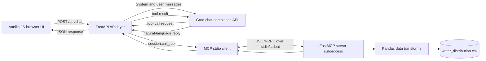

# Rujwasco Distribution Intelligence

Rujwasco Distribution Intelligence is a local, full-stack analytical chat application that combines a conversational LLM with deterministic data analysis tools. It uses Groq for model inference, FastAPI as the HTTP and orchestration layer, and the Model Context Protocol (MCP) to expose read-only pandas calculations over a structured, type-described tool interface.

The application is grounded in `data/water_distribution.csv`. The model does not receive direct database or filesystem access. It decides when to invoke registered MCP tools, while the backend validates tool names and arguments, executes the tool, and returns the result to the model for synthesis.

> The supplied data is synthetic practice data. The apparent unaccounted-for-volume (UAV) indicator is not a verified Non-Revenue Water (NRW) balance.

## Architecture



### Runtime components

| Component | Responsibility |
|---|---|
| `static/index.html` | Responsive single-page interface, local chat state, event handling, scoped prompts, and result rendering |
| `app.py` | FastAPI routes, Pydantic request/response schemas, Groq configuration, MCP lifecycle, function-call orchestration |
| `server.py` | Read-only FastMCP tool server and deterministic pandas calculations |
| `data/water_distribution.csv` | Synthetic source dataset loaded into memory by the MCP server |
| `.env` | Local secrets and runtime configuration loaded with `python-dotenv` |

## Technology stack

### Backend

- **Python 3.10+**: runtime, async orchestration, and data processing
- **FastAPI**: ASGI HTTP framework and OpenAPI-compatible route definitions
- **Pydantic**: runtime request validation and response serialization
- **Uvicorn**: local ASGI server
- **Groq Python SDK**: OpenAI-compatible asynchronous chat-completion and function-calling client
- **Model Context Protocol SDK**: MCP client/session management and stdio transport
- **FastMCP**: MCP tool registration, input schema generation, and stdio server lifecycle
- **Pandas**: CSV loading, filtering, aggregation, correlation, and JSON-safe result conversion
- **python-dotenv**: environment and secret loading

### Frontend

- **HTML5**: semantic page structure
- **CSS3**: responsive grid layout, custom properties, transitions, and mobile sidebar behavior
- **Vanilla JavaScript**: no framework or virtual DOM dependency
- **Fetch API**: JSON POST/GET communication with the backend
- **LocalStorage**: persistent conversations and UI scope state
- **Browser APIs**: Clipboard, URL objects, keyboard events, touch gestures, and dynamic DOM rendering

## Core programming concepts

### Separation of concerns

The system separates three concerns:

1. **Presentation** lives in `static/index.html`.
2. **LLM/MCP orchestration** lives in `app.py`.
3. **Dataset access and calculations** live in `server.py`.

The browser cannot query the CSV or invoke pandas directly. It can only call the HTTP API. Likewise, the MCP server is not responsible for LLM prompting and the Groq client does not read source files.

### Asynchronous I/O

FastAPI routes and Groq/MCP operations use `async` and `await`. The MCP process is opened as an asynchronous subprocess, and client sessions manage message streams without blocking the HTTP event loop.

### Structured function calling

MCP tool metadata is converted into Groq/OpenAI-compatible function declarations by `build_groq_tools()`:

- `tool.name` becomes the function name.
- `tool.description` becomes the function description.
- `tool.inputSchema` becomes the JSON-Schema parameter definition.

Groq returns a tool call rather than directly calculating an answer. The backend matches that name against the `available_tools` dictionary discovered from MCP and calls `session.call_tool(...)` with parsed JSON arguments.

The orchestration permits up to six model rounds. A round ends in one of three states:

1. A normal assistant response, with no tool calls.
2. One or more tool calls to execute, followed by another model round.
3. The six-round ceiling, at which the backend stops and asks for a narrower question.

### Model Context Protocol

MCP uses JSON-RPC messages exchanged through process stdin and stdout. `server.py` is launched as a child process configured in `StdioServerParameters`. `stdio_client()` supplies asynchronous read/write streams, and `ClientSession.initialize()` performs protocol initialization before tool discovery.

This design provides a stable boundary:

- Tools are discoverable at runtime.
- Inputs are described with JSON Schema.
- Tool execution is not tied to an HTTP endpoint.
- The data process can be replaced or deployed independently later.
- The MCP server remains read-only.

### Pydantic validation

`ChatRequest` validates inbound JSON before route handling:

```python
class ChatRequest(BaseModel):
    message: str = Field(min_length=1, max_length=12000)
```

`ChatResponse` fixes the response contract:

```python
class ChatResponse(BaseModel):
    reply: str
    model: str
    tools_used: list[str]
```

Unknown JSON fields are ignored by Pydantic by default. This matters because the current frontend sends `previous_interaction_id`, but the backend does not expose a conversation-state field and does not maintain provider interaction IDs.

### Data loading and caching

`server.py` validates required columns, coerces date and numeric fields, trims zone names, and rejects invalid dates or missing schema fields.

The module caches a pandas DataFrame and its source modification time:

- A cache hit avoids re-reading unchanged CSV data.
- A modified CSV reloads the dataset.
- Optional start/end dates are inclusive.
- Reversed date ranges and empty filtered datasets raise explicit errors.
- Zone matching is case-insensitive and validates against available zones.

Every returned DataFrame is converted to JSON-safe Python records. NumPy scalars, pandas `NA`, `NaN`, and date values receive explicit conversion so FastMCP can serialize them safely.

## Dataset contract

The CSV is expected to contain:

| Column | Meaning |
|---|---|
| `date` | Daily observation date |
| `zone` | Distribution zone identifier |
| `water_input_m3` | Recorded volume entering the zone |
| `water_billed_m3` | Recorded volume billed to customers |
| `average_pressure_bar` | Zone average pressure |
| `supply_hours` | Daily supply duration |
| `burst_incidents` | Count of burst incidents |
| `repair_hours` | Time spent repairing bursts |
| `active_connections` | Number of active customer connections |

Numeric fields are normalized through `pd.to_numeric(..., errors="coerce")`. Invalid values become missing values rather than silently passing into calculations.

## MCP tool catalog

| Tool | Deterministic behavior |
|---|---|
| `get_dataset_overview` | Row count, period, zones, columns, missing values, and duplicate records |
| `get_water_input_by_zone` | Grouped input totals and daily averages |
| `get_supply_hours` | Mean, minimum, maximum, and standard deviation of supply hours |
| `get_pipe_burst_analysis` | Burst totals, repair totals, and grouped repair averages |
| `get_pressure_analysis` | Mean, minimum, maximum, and standard deviation of pressure |
| `get_pressure_burst_correlation` | Pearson correlation between pressure and burst incidents |
| `get_water_loss_analysis` | Apparent input minus billed volume and apparent UAV percentage |
| `compare_zones` | Side-by-side zone metrics for at least two requested zones |
| `get_daily_trends` | Chronological single-metric trend for one zone |

Tool definitions and implementation schemas are generated from Python type hints and docstrings. The MCP SDK uses these declarations to help both tool discovery and Groq function-call generation.

### UAV calculation

For each zone:

$$
UAV = water\ input - billed\ volume
$$

$$
UAV\% = \frac{UAV}{water\ input} \times 100
$$

A division by zero is guarded and returns `null` instead of infinity or `NaN`. This indicator does not include authorised unbilled consumption, meter uncertainty, measurement-period reconciliation, or other components required for a verified NRW water balance. It must not be presented as such.

### Correlation interpretation

`get_pressure_burst_correlation` uses pandas' Pearson correlation implementation:

$$
r = \frac{\sum (x_i - \bar{x})(y_i - \bar{y})}
{\sqrt{\sum (x_i - \bar{x})^2 \sum (y_i - \bar{y})^2}}
$$

The tool returns the coefficient, observation count, period, and an explicit causation warning. Pearson correlation only measures linear association in the supplied observations.

## API contract

### `GET /`

Returns `static/index.html` as a `FileResponse`.

### `GET /static/<path>`

Serves static assets from the `static` directory, including CSS embedded in the HTML and the logo image.

### `GET /api/health`

Returns provider and runtime status:

```json
{
  "status": "ok",
  "provider": "Groq",
  "model": "openai/gpt-oss-120b",
  "api_key_configured": true,
  "mcp_server_exists": true,
  "python_executable": "/path/to/python"
}
```

This endpoint is informational. It does not test network connectivity to Groq or execute an MCP tool call.

### `POST /api/chat`

Request:

```json
{
  "message": "Compare pressure and bursts in Zone A",
  "previous_interaction_id": null
}
```

The current `ChatRequest` model consumes only `message`; extra fields are ignored.

Response:

```json
{
  "reply": "Zone A showed ...",
  "model": "openai/gpt-oss-120b",
  "tools_used": [
    "get_pressure_analysis",
    "get_pipe_burst_analysis"
  ]
}
```

A model or MCP failure is logged with nested exception details and returned by FastAPI as HTTP `502` with a sanitized exception summary.

## Frontend state model

The frontend is stateful but does not use a framework or remote session store.

Important browser state includes:

- Chat and message history
- Current chat identifier
- Selected zones and date range
- Expanded sidebar categories
- Sidebar and mobile drawer state
- Banner dismissal state
- Pending request state

State is persisted in `localStorage` using a versioned application key. Prompts are augmented with user-selected zone and date scope before submission.

The UI adds brief typing animation after receiving a response, supports copying and exporting tool tables, and renders CSV downloads using `Blob` and object URLs.

## Request lifecycle

For `POST /api/chat`, the backend performs the following sequence:

1. Validate the Pydantic request model.
2. Create an asynchronous Groq client.
3. Construct system and user messages.
4. Configure MCP stdio process parameters.
5. Launch `server.py` through the selected Python executable.
6. Initialize the MCP client session.
7. Discover available tools and convert schemas into Groq tools.
8. Send the prompt and tool definitions to Groq.
9. Parse any returned tool-call arguments as JSON.
10. Reject unknown tool names and isolate tool exceptions.
11. Append tool results to the model conversation with matching tool-call IDs.
12. Repeat through Groq's function-calling loop or stop on a final response.
13. Return the reply, model identifier, and deduplicated tool usage list.

Starting a new chat in the frontend only replaces local browser conversation state. It does not reset Groq server-side state because this implementation does not maintain provider interaction IDs.

## Configuration

Create a `.env` file in the project root:

```env
GROQ_API_KEY=your_groq_api_key
GROQ_MODEL=openai/gpt-oss-120b
PYTHON_EXECUTABLE=/absolute/path/to/python
RUJWASCO_DATA_PATH=/absolute/path/to/water_distribution.csv
```

| Variable | Required | Default | Purpose |
|---|---|---|---|
| `GROQ_API_KEY` | Yes | None | Authenticates requests to Groq |
| `GROQ_MODEL` | No | `openai/gpt-oss-120b` | Groq model identifier |
| `PYTHON_EXECUTABLE` | No | `sys.executable` | Interpreter used to launch `server.py` |
| `RUJWASCO_DATA_PATH` | No | `data/water_distribution.csv` | Dataset path used by the MCP server |
| `LOG_LEVEL` | No | `INFO` | MCP server log verbosity |

`PYTHON_EXECUTABLE` should point to the interpreter that has the project dependencies. `RUJWASCO_DATA_PATH` is useful for isolated test fixtures or deployments with a mounted dataset.

Never place `GROQ_API_KEY` in HTML or commit `.env`. The key is read only by the Python backend.

## Installation

### Linux / WSL

```bash
cd rujwasco-water-distribution
python3 -m venv .venv
source .venv/bin/activate
python -m pip install --upgrade pip
pip install -r requirements.txt
```

### Windows PowerShell

```powershell
cd rujwasco-water-distribution
py -m venv .venv
.venv\Scripts\Activate.ps1
python -m pip install --upgrade pip
pip install -r requirements.txt
```

Create `.env` and then start the application:

```bash
uvicorn app:app --host 127.0.0.1 --port 8000 --reload
```

Open `http://127.0.0.1:8000`.

## Development workflow

Run the MCP server directly for protocol-level testing:

```bash
python server.py
```

Run with Uvicorn while editing:

```bash
uvicorn app:app --reload
```

Before changing MCP tools, confirm that:

- Function names remain unique.
- Parameters have explicit Python types.
- Optional parameters use `T | None` or an equivalent schema.
- Empty or unknown zones and date ranges return useful errors.
- Output uses JSON-native values, not pandas or NumPy scalars.
- Tool docstrings describe the calculation accurately and disclose methodology limitations.

## Extending the application

### Adding an MCP tool

1. Add a function in `server.py`.
2. Decorate it with `@mcp.tool()`.
3. Declare typed parameters and return a JSON-safe dictionary or list.
4. Reuse `_read_dataset()`, `load_data()`, `filter_zone()`, and `records()` where appropriate.
5. Restart `app.py` so the MCP process is rebuilt and tool discovery sees the new contract.

Example:

```python
@mcp.tool()
def get_active_connection_summary(zone: str | None = None) -> dict:
    """Summarize active connections by zone."""
    data = filter_zone(load_data(), zone)
    result = (
        data.groupby("zone")["active_connections"]
        .agg(mean="mean", minimum="min", maximum="max")
        .reset_index()
        .round(2)
    )
    return {"period": period_of(data), "by_zone": records(result)}
```

### Adding a frontend action

Frontend commands use a delegated `data-a` action system. A button or element supplies an action identifier and optional data attributes; one document-level click listener dispatches to `ACTIONS`.

This pattern keeps event wiring centralized, but it can become difficult to scale because each state transition mutates and rerenders the DOM. A framework or state reducer would become appropriate if the application grows beyond a small operational dashboard.

## Error handling

Tool failures are isolated from the model loop:

- Invalid JSON tool arguments produce a tool message containing an error object.
- Unknown tool names produce a structured unknown-tool error.
- MCP exceptions are logged and converted into JSON error content.
- `BaseExceptionGroup` errors are flattened into readable messages.
- FastAPI converts top-level orchestration failures into HTTP 502 responses.

This prevents one malformed tool call from crashing the complete ASGI process. It does not yet implement retry backoff or provider circuit breaking.

## Security and deployment considerations

This repository is a local development application. Before internet exposure, add:

- Authentication and authorization
- Request and origin validation
- Rate limiting and concurrency limits
- HTTPS termination
- Secret management instead of plaintext `.env` files
- Per-user provider quotas
- Input and output moderation
- Persistent audit logging
- MCP process resource limits
- CSV file integrity and access controls
- CORS policy where the frontend and API use separate origins
- Timeouts for Groq requests and MCP calls
- Structured health/readiness checks

Do not expose port 8000 directly to the internet. The current implementation is intended for a trusted local network or development workstation.

## Limitations

- The frontend and backend share one origin in the current design.
- Conversation memory is browser-local; it is not stored in FastAPI or Groq interaction state.
- Tool calls have no independent retry or idempotency strategy.
- The MCP server process is recreated for every `/api/chat` request.
- The system has no persistent database, vector store, or retrieval pipeline.
- The CSV is not a production data warehouse.
- Dataset mutations are not supported by MCP tools.
- The provider temperature is fixed at `0.2`.
- Tool usage is reported as a list without timing or arguments.
- The loss calculation is an apparent UAV indicator, not an engineering NRW balance.

## Repository structure

```text
.
├── app.py                              # FastAPI app and Groq/MCP orchestrator
├── server.py                           # FastMCP server and pandas tools
├── static/
│   ├── index.html                      # Browser application
│   └── ruiru-juja-water-and-sewarage-company-logo.png
├── data/
│   └── water_distribution.csv          # Synthetic analytical dataset
├── requirements.txt                    # Python dependencies
└── README.md                           # Architecture and developer documentation
```

## Example queries

- Give me an overview of the dataset and its date coverage.
- Which zone has the highest number of pipe bursts?
- Compare water losses across all zones.
- Compare Zone C and Zone D.
- Show daily pressure readings for Zone A between 2026-08-01 and 2026-08-15.
- Is pressure correlated with burst incidents?
- Summarize supply duration and pressure variability for the selected period.
